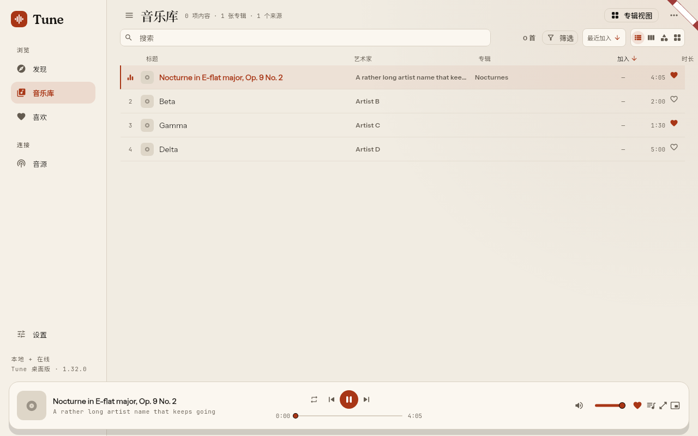
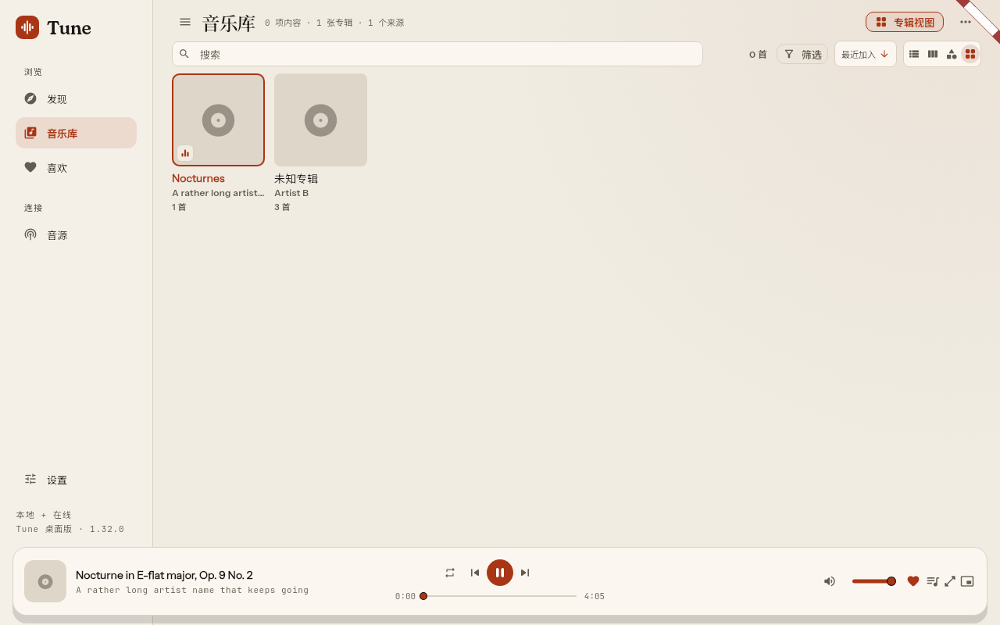

# Tune

> 状态：入口 · 适用版本 1.33.0 · 最后核对 2026-11-15

[中文](README.md) · [English](README_en.md)

[](https://github.com/pengtang1024/tune/actions/workflows/ci.yml)
[](https://github.com/pengtang1024/tune/releases)
[](LICENSE)
[](https://flutter.dev)

Tune 是一款紧凑的本地与在线音乐播放器，使用 Flutter 开发。界面由左侧导航（发现 / 音乐库 / 喜欢 / 音源 / 设置）、右侧内容区和底部播放条组成；播放队列是底栏或正在播放页打开的非模态侧栏，不占用导航位；它只遮住内容区，底栏和侧栏仍可用。

- **当前版本**：`1.39.1+76`（代号 `Pocket`，2026-11-16）。版本号与构建号在 [pubspec.yaml](pubspec.yaml) 和 `lib/config/app_version.dart`；最新发布清单是仓库根的 [version.json](version.json)。
- **主要验收平台**：Linux 桌面。Windows / Android / iOS 保留工程入口；macOS 与 Web 已移除。
- **源码与文档**：[AGENTS.md](AGENTS.md) 是工程文档地图；设计说明在 [docs/](docs/)，代码结构导览在 [wiki/](wiki/)，需求入口是 [需求/README.md](需求/README.md)。用不了先看 [故障排查](docs/troubleshooting.md)。

## 目录

- [界面](#界面)
- [功能](#功能)
- [技术栈](#技术栈)
- [项目结构](#项目结构)
- [运行](#运行)
- [构建与产物](#构建与产物)
- [本地组件与离线包](#本地组件与离线包)
- [自动更新](#自动更新)
- [桌面图标](#桌面图标)
- [已知限制](#已知限制)
- [参与贡献](#参与贡献)
- [文档索引](#文档索引)
- [许可证](#许可证)

## 界面





截图由 `tool/layout_shots_test.dart` 在 1280×800 下按真实组件渲染，曲目是演示数据；界面改动后重跑该脚本即可更新（见 [docs/verification.md](docs/verification.md)）。

## 功能

**音乐库**
- 本地音乐目录扫描（Linux 目录遍历、Android MediaStore / SAF）、搜索与 SQLite 持久化；库不入内存，始终是数据库读出的 1000 首窗口
- 左侧分类树（流派 / 年代 / 艺术家 / 音源 / 语言 / 格式 / 内容类型）、分面筛选面板（内容类型 / 状态 / 流派 / 年代 / 艺术家 / 音源 / 语言 / 格式 / 时长 / 短曲目 / 加入时间）与生效 chip；筛选在 SQL 层做
- 视图随内容分类走：音乐默认是**分栏**——左列专辑、右列这张专辑的曲目，两列同屏；另有歌曲 / 双列 / 分类 / 专辑墙 / 合集。播客是节目与单集两列，有声书是书与章节，电台只有台列表，音效平铺。切到哪一类就打开它自己的默认读法。合集按来源分组，点开是那一个来源的专辑墙，可一键清空某个合集带来的曲目
- 按内容类型浏览（歌曲 / 专辑 / 电台 / 语音节目），同名语音节目跨源合并
- 按来源筛选，远程歌曲显示来源与封面；曲目行用图标标识格式、音质、码率等，悬停看说明、点开看完整信息与文件路径

**音源**
- 30 个注册类型、30 个适配器文件：本地目录、Openverse、Jamendo、Internet Archive（含 Live Music Archive、Great 78、Netlabels、Free Music Archive 等多个内置精选实例）、ccMixter、iTunes 试听、Deezer 预览、播客 RSS / 播客目录 / Apple 播客、Audius、Wikimedia Commons、网络电台、PeerTube、LibriVox、Funkwhale，以及自建 / 自托管服务（Subsonic / Navidrome、Ampache、Koel、Jellyfin、Emby、Plex、Audiobookshelf、Kodi、LMS、AzuraCast）
- 自己添加音源：挑一个类型（直链音频、M3U 播放列表、JSON 接口、GraphQL 接口……），填上参数就是一个新实例；同一类型可以加好几个。只接受声明式参数，不执行任意脚本
- 音源有权重、健康度维度与排序，低健康度音源在推荐里降权；远程地址失效时，实现了单曲刷新的音源（Subsonic / Navidrome、Ampache、Koel、Emby、Plex、Jellyfin、Deezer、播客 RSS）会重新解析单曲，其余需重新扫描

**播放与队列**
- 播放队列增删除、拖拽重排、点播与清空；游标用曲目身份，随机重排，上一首走播放历史
- 播放 / 暂停、上一首 / 下一首、进度拖拽、音量与循环模式；启动可恢复播放
- 迷你播放器是贴任务栏的 360×88 播放条
- Linux 桌面集成：系统托盘常驻（关窗口后继续播放）、MPRIS 系统媒体控制（键盘媒体键、`playerctl`）、可设为音频文件的默认程序、单实例

**歌词与本地 AI**
- 智能歌词：默认自动补齐到每首有词，人写票池 + 本地 Whisper / SenseVoice / 可选 Fun-ASR-Nano；可见票数与来源，支持改词、标记、翻译 / 音译对照
- 1.32.0 起翻译默认走设置页配置的厂商 API；离线翻译模型、ASR 模型与 FFmpeg 收敛到统一组件注册表，在设置页按需下载并校验大小与 sha256（见 [docs/local-components.md](docs/local-components.md)）
- Android 上智能歌词走 `sherpa_onnx` FFI 本地识别，音频经 MediaCodec 硬解

**喜欢、发现与设置**
- 喜欢：曲目行、播放队列、在线搜索结果、正在播放页与底栏播放卡片都有红心，标过的曲子收在「喜欢」页
- 发现：从音乐库和喜欢里挑今日混音、歌手与流派分段；只在本机计算，不请求音源接口；可选开启本地播放记录改善推荐；可按歌手显式在线找更多；单曲与歌手都能少推荐（可撤销）；已在队列里的曲目会降权
- 设置页：12 个分区导航（概览 / 外观 / 音乐库 / 播放 / 歌词 / 语言 / 本地组件 / 发现 / 桌面 / 权限 / 健康度 / 关于），其中 6 个分区提供预设（外观 / 音乐库 / 播放 / 歌词 / 发现 / 桌面）；另有自定义 sheet、搜索与恢复默认
- 浅色 / 深色 / 系统主题；界面语言：简体中文、繁體中文、中文（通用）、English，切换后音源名、日期与数字格式一起跟随
- 窗口：首帧 900×600（GTK runner），运行时首次启动默认 1120×760、最小 760×520；紧凑布局按 900×600 设计验收

## 技术栈

- Flutter 3 / Dart 3.8+ · Riverpod 2 · go_router
- just_audio；**Linux 与 Windows 都走** just_audio_media_kit + media_kit_libs_linux / media_kit_libs_windows_audio + 系统 libmpv（Windows 后端会携带自定义请求头）
- SQLite（`sqlite3` + `sqlite3_flutter_libs`）· dio · `window_manager` · `dbus`
- `audio_service`（Android 后台播放 / 通知 / 锁屏）· `permission_handler`（Android 运行时权限）· `sherpa_onnx`（Android 本地 ASR）
- `shared_preferences` 仅用于旧数据迁移 · flutter_localizations / gen-l10n · `logger`
- 测试：`flutter_lints` ^6 · `fake_async` · `integration_test`

音源模型与扩展方式见 [需求/音源设计.md](需求/音源设计.md)，架构与状态归属见 [docs/architecture.md](docs/architecture.md)。

## 项目结构

```text
lib/
├── app/                  # 应用入口、路由、主题、壳层、快捷键
├── config/               # 启动初始化、版本号
├── core/                 # 平台常量、能力表、扩展、日志、窗口管理、桌面服务
├── data/services/        # 音频、扫描、音源适配器、数据库、持久化、本地组件、智能歌词
├── domain/models/        # Song、音源配置、专辑等模型
├── features/             # 13 个 feature，各自 application / domain / presentation
├── l10n/                 # 国际化资源（4 个 ARB）
├── providers/            # 全局 provider（持久化、封面等）
├── shared/               # 通用 UI 与工具
└── utils/                # 日志、稳定键、文件名等小工具
```

13 个 feature：`desktop`、`discovery`、`favorites`、`library`、`local_components`、`localization`、`player`、`queue`、`search`、`settings`、`shell`、`smart_lyrics`、`sources`。逐层职责见 [wiki/](wiki/)。

## 运行

```bash
flutter pub get
flutter run -d linux
```

验证门禁（`flutter` 若不在 PATH，用 `export PATH="/opt/flutter/bin:$PATH"`）：

```bash
./tool/check.sh --l10n --tools --docs   # gen-l10n 一致性 + analyze + 用例 + 截图探针 + 文档结构；CI 跑的就是这条
```

分步等价：`flutter analyze`（必须 No issues found）、`flutter test`（全绿）、改过文案再 `flutter gen-l10n` 并提交产物。细节见 [docs/verification.md](docs/verification.md)。

## 构建与产物

默认安装包不含本地模型，Linux 归档约 **51 MiB**（根 [version.json](version.json) 的 `linux-x64.size` = 53,600,275 B）。升级替换应用不会删除已下载的本地组件。

```bash
flutter build linux --release
./tool/package_linux.sh    # dist/tune-linux-x64-<version>.tar.gz
```

Windows / Android / iOS 保留工程入口，要在对应系统上构建：

| 平台 | 命令 | 前置条件 |
| --- | --- | --- |
| Linux | `flutter build linux --release` | 系统装有 libmpv（`libmpv2`） |
| Windows | `flutter build windows --release` | Visual Studio 的 C++ 桌面工作负载 |
| Android | `flutter build apk --release` | 可选 `android/key.properties`，见下 |

macOS 与 Web 不再支持：平台工程入口与相关代码已移除。Android 的 release 签名从 `android/key.properties` 读取 `storeFile`、`storePassword`、`keyAlias`、`keyPassword`；没有该文件时回落到 debug 签名，产物只能本机试装。

## 本地组件与离线包

1.32.0 起，翻译模型（llama.cpp 运行时 + Qwen 系列 GGUF）、歌词 ASR 模型（Whisper / SenseVoice / Fun-ASR-Nano / Android FFI Whisper ONNX）与 FFmpeg 统一由 [docs/local-components.md](docs/local-components.md) 描述的注册表管理，落在应用支持目录 `<support>/components/<id>/`，在设置页按需下载并校验大小与 sha256。翻译默认档是 Qwen3-0.6B（约 610 MB），另有低配 Qwen2.5-0.5B（约 469 MiB）与高质量 Qwen2.5-1.5B（约 1.1 GB）；`<support>/translation/` 只作旧版兼容读取。FFmpeg 由 `tool/build_ffmpeg.sh` 从源码编译 8.0.1，GPL-2.0-or-later，归档内带 `COPYING.GPLv2`。

离线打包链路单独保留：[translation/manifest.json](translation/manifest.json) 指向 Release 组件包 `tune-translation-qwen2.5-0.5b-b12274.zip`（modelBytes 491,400,032 ≈ 469 MiB），`tool/prepare_translation.sh` 与 `tool/package_linux.sh --offline` 仍在用它。需要打离线包时，先从同版本 Release 下载组件包，把 `translation/models/`、`translation/bin/` 与 `translation/licenses/` 解压到仓库的 `translation/` 下再运行脚本；缺文件会直接报错。它是「离线打包用的翻译组件」，不再是唯一的本地组件；在线用户按统一注册表下载。详见 [docs/updates.md](docs/updates.md) 与 [docs/local-components.md](docs/local-components.md)。

## 自动更新

设置页「关于」下方有「检查更新」：桌面端读仓库根静态清单 [version.json](version.json) 发现新版本（jsDelivr CDN `@master` → raw.githubusercontent `@master` → GitHub release API 兜底），下载对应平台的归档并换掉正在运行的 bundle，重启后生效。

- 后台约 1 h 定时检查（±10% 抖动，54–66 min），两次检查最小间隔 15 min；失败按 30 min → 1 h → 2 h 退避封顶，成功后回到 1 h 节奏
- 设置页手动检查不受节流；10 min 内存复用窗口与 ETag / 304 按源持久化
- 整包更新只替换应用本身，`<support>/components/` 里已下载的本地组件不会被删除
- 清单签名验证尚未实施，见 [docs/update-cdn.md](docs/update-cdn.md) §7

Linux 的打包与发布步骤见 [docs/updates.md](docs/updates.md)，清单字段、调度与退避口径见 [docs/update-cdn.md](docs/update-cdn.md)。1.5.0 之前的版本没有更新入口，用 `./tool/upgrade_local.sh` 升级一次；之后由应用自己检查更新。

## 桌面图标

- 原图是 `branding/app_icon.png`；改完原图后跑 `dart run flutter_launcher_icons` 重新生成各平台图标。原图不进包，`assets/` 里只放运行时要用的素材。
- Linux 的主题图标另有一条规则：图形缩到画布的 13/16 留出透明边，跟别的应用一样大。改完原图再跑 `dart run tool/generate_linux_icons.dart`。
- Linux 的 dock 与任务栏图标来自桌面项，程序自身也带一份窗口图标。
- 桌面项要装进本机的 XDG 目录，dock 才会显示 Tune 的图标（每次换机器装一次）：

```bash
flutter build linux --debug
./linux/install-desktop-entry.sh
```

## 已知限制

- 当前主要验收平台为 Linux 桌面端；macOS 与 Web 不再支持。
- 远程播放依赖网络；桌面端边播边缓存，播放不等待下载。网络电台是直播流，不缓存、不显示进度条。
- Windows 与 Linux 一样用 media_kit（libmpv）播放，自定义请求头随音频请求发出，需要 token 的音源可以播放；但 Windows 仍没有托盘、SMTC、默认播放器与自动更新，单实例靠回环端口实现（端口被占用时退化为独立运行）。待办与验证条件见 [docs/architecture.md](docs/architecture.md) 的「Windows 桌面集成待办」。
- Android 已用 `permission_handler` 申请通知与媒体读取权限，MediaStore 扫描、SAF 指定文件夹（S1–S3）与 `audio_service` 后台播放 / 通知 / 锁屏控制都已接（见 [docs/android.md](docs/android.md)）；队列仍由 `PlaybackController` 独占，耳机实体按键、锁屏视觉与长时间后台仍需真机复核。iOS 仅保留工程入口，不排期。
- 均衡器、播放历史与账号系统不在 v1 主链路内；Android 的后台播放 / 通知 / 锁屏是单独实现的 Android 能力，不属于桌面主链路。
- 远程播放地址可能过期；仅上述 8 类实现 `refreshStream` 的音源支持单曲刷新，其余音源需重新扫描。
- 不支持任意脚本插件：曾支持的 MusicFree JS 插件能力已下线，自定义音源只接受声明式参数。

## 参与贡献

欢迎提交 issue 与 PR。提问、报缺陷、提需求统一走 [GitHub Issues](https://github.com/pengtang1024/tune/issues)；Gitee 与 Gitea 是镜像，反馈以 GitHub 为准。公开主仓是 <https://github.com/pengtang1024/tune>。

**快速上手**

1. 在 GitHub 上 fork 主仓，再克隆自己的 fork。
2. 从 `develop` 切出分支（主线是 `develop`，不是 `master`）。
3. 改完按下面的门禁自查。
4. 向 `develop` 提 PR。

**门禁命令**

```bash
./tool/check.sh --l10n   # gen-l10n 一致性 + analyze + 确定性用例
```

`flutter` 若不在 PATH，先 `export PATH="/opt/flutter/bin:$PATH"`。等价的分步命令是 `flutter pub get`、`flutter analyze`、`flutter test`，改过文案再 `flutter gen-l10n` 并提交产物。

**联网测试**：`test/services/music_source_e2e_live_test.dart` 与 `test/services/music_source_live_test.dart` 访问真实外部服务，离线或外部服务 404 时失败属正常，与你的改动无关；要排查这两个文件用 `./tool/live_sources.sh`。

**提交约定**：`type(scope): 中文说明`，一次提交只做一件事；`type` 取 `feat` / `fix` / `refactor` / `docs` / `chore` / `perf`。不要 `git add .`，精确指定文件；不要 force push 到 `main` / `master`。

**行为准则与安全**：参与即表示同意 [CODE_OF_CONDUCT.md](CODE_OF_CONDUCT.md)。发现安全漏洞请按 [SECURITY.md](SECURITY.md) 私下报告，不要开公开 issue。

**更多**：完整流程见 [CONTRIBUTING.md](CONTRIBUTING.md)，提问渠道见 [SUPPORT.md](SUPPORT.md)，治理与决策见 [GOVERNANCE.md](GOVERNANCE.md)，作者见 [AUTHORS.md](AUTHORS.md)。

贡献按 [MIT License](LICENSE) 授权：你保留自己贡献的版权，代码以 MIT 条款分发；本项目不使用 CLA，提交 PR 即表示你同意按此授权。

## 文档索引

| 想查什么 | 去哪 |
| --- | --- |
| 全部规则的入口、改动优先级 | [AGENTS.md](AGENTS.md) |
| 设计文档全索引与状态约定（哪份算规范） | [docs/README.md](docs/README.md) |
| 分层、状态归属、依赖方向、扩展路径 | [docs/architecture.md](docs/architecture.md) |
| 代码结构导览（关键类、模块、依赖） | [wiki/](wiki/) |
| 需求与验收范围（五份现行文档） | [需求/README.md](需求/README.md) |
| 音源类型、权重与适配器注册 | [需求/音源设计.md](需求/音源设计.md)、[docs/source-extension.md](docs/source-extension.md) |
| 自动更新清单、CDN 与退避 | [docs/updates.md](docs/updates.md)、[docs/update-cdn.md](docs/update-cdn.md) |
| 本地组件、Android、性能、验证门禁 | [docs/local-components.md](docs/local-components.md)、[docs/android.md](docs/android.md)、[docs/performance.md](docs/performance.md)、[docs/verification.md](docs/verification.md) |
| 编码、日志、主题、许可证约定 | [docs/conventions.md](docs/conventions.md)、[docs/licensing.md](docs/licensing.md) |
| 用不了、要排障（常见现象与处理） | [docs/troubleshooting.md](docs/troubleshooting.md) |

## 许可证

Tune 的源代码采用 [MIT License](LICENSE)。内置字体采用 SIL OFL-1.1；Dart/Flutter 依赖的许可证随安装包的 `NOTICES` 分发；Linux 播放依赖系统的 libmpv（Ubuntu 打包为 GPL-3+，不随 Tune 分发）；本地 FFmpeg 组件为 GPL-2.0-or-later，由本项目自行构建发布。完整的第三方声明见 [THIRD_PARTY_NOTICES.md](THIRD_PARTY_NOTICES.md) 与 [docs/licensing.md](docs/licensing.md)。

## 相关文档

- [文档地图](AGENTS.md) — 每类改动该读哪份文档
- [参与贡献](CONTRIBUTING.md) — 分支、门禁与提交流程
- [文档索引](docs/README.md) — 设计文档的状态与适用范围
- [需求入口](需求/README.md) — 产品范围与验收口径
- [获取帮助](SUPPORT.md) — 提问与排障渠道
