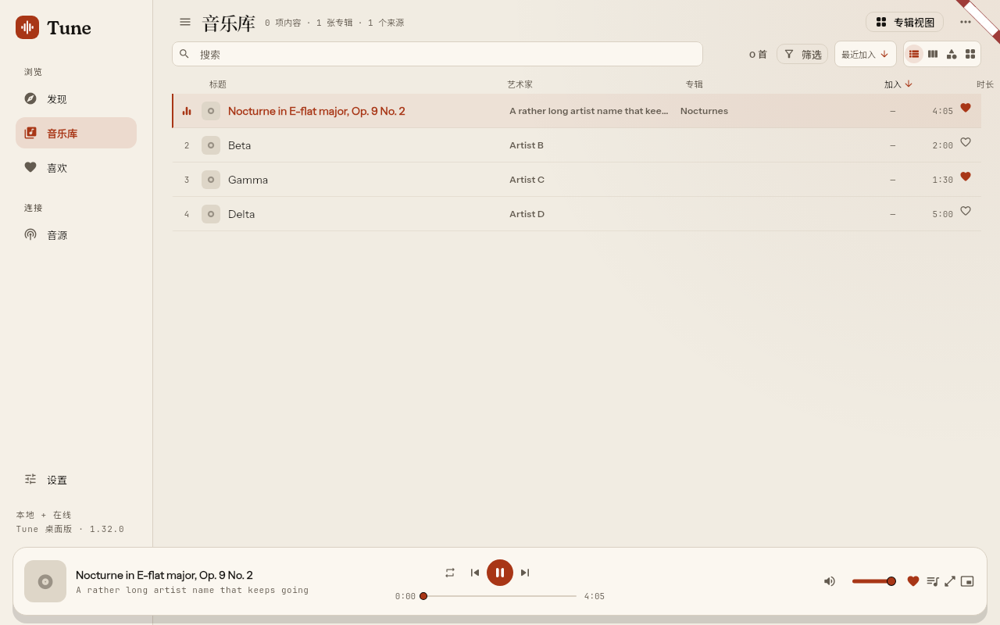
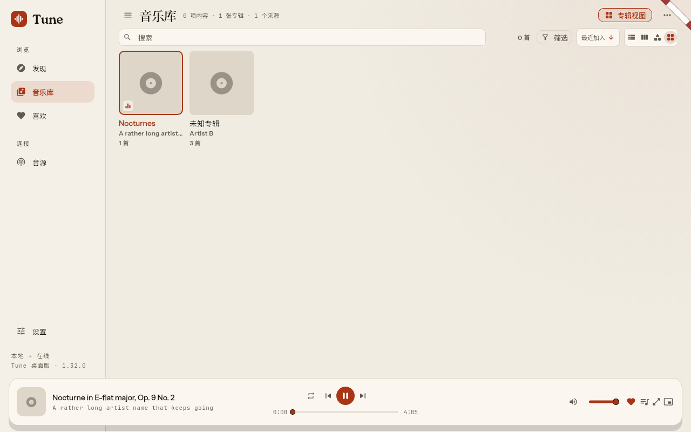

# Tune

> 状态：入口 · 适用版本 1.33.0 · 最后核对 2026-11-15

[中文](README.md) · [English](README_en.md)

[](https://github.com/pengtang1024/tune/actions/workflows/ci.yml)
[](https://github.com/pengtang1024/tune/releases)
[](LICENSE)
[](https://flutter.dev)

Tune is a compact local and online music player built with Flutter. The shell has a navigation rail (discover, library, liked, sources, settings), a content area, and a player dock at the bottom; the play queue is a non-modal side panel opened from the dock or the now playing page, not a navigation destination; it dims the page content while the dock and sidebar stay usable.

- **Current version**: `1.48.0+97` (codename `Pocket`, 2026-11-17). Version and build number live in [pubspec.yaml](pubspec.yaml) and `lib/config/app_version.dart`; the published manifest is the root [version.json](version.json).
- **Primary target**: Linux desktop. Windows / Android / iOS keep an engineering entry point; macOS and Web have been removed.
- **Source and docs**: [AGENTS.md](AGENTS.md) is the documentation map; design notes live in [docs/](docs/), a code-structure tour in [wiki/](wiki/), and the requirements entry point is [需求/README.md](需求/README.md). When something does not work, start with [Troubleshooting](docs/troubleshooting.md).

## 目录

- [Screens](#screens)
- [Features](#features)
- [Stack](#stack)
- [Structure](#structure)
- [Run](#run)
- [Build and artifacts](#build-and-artifacts)
- [Local components and offline bundles](#local-components-and-offline-bundles)
- [Auto update](#auto-update)
- [Desktop icon](#desktop-icon)
- [Known limitations](#known-limitations)
- [Contributing](#contributing)
- [Documentation index](#documentation-index)
- [License](#license)

## Screens





The shots are rendered by `tool/layout_shots_test.dart` at 1280×800 from the real widgets, with sample tracks; rerun that script after a UI change (see [docs/verification.md](docs/verification.md)).

## Features

**Library**
- Local music folder scanning (directory walk on Linux, MediaStore / SAF on Android), search, and SQLite persistence; the library is never loaded into memory, it is always a 1000-track window read from the database
- A category drawer (genre / decade / artist / source / language / format / content kind), a faceted filter panel (content kind / status / genre / decade / artist / source / language / format / duration / short tracks / date added) with active chips; filtering happens in SQL
- Views follow the kind of content: music opens as a **split view** — albums on the left, this album's tracks on the right, both on screen — plus songs / two-column / categories / album wall / collections. Podcasts are shows and episodes, audiobooks are books and chapters, radio is just stations, sound effects are a flat list; switching kinds opens that kind's own default. A collection groups the rows by where they came from, opens as that reach's album wall, and can be emptied in one step
- Browse by content kind (songs / albums / radio / spoken-word shows), with same-named spoken-word shows merged across sources
- Filter by source; remote tracks show source and artwork; track rows mark format, quality, and bitrate with icons — hover to read them, open a track for all of its facts and its path

**Sources**
- 30 registered types and 30 adapter files: local folders, Openverse, Jamendo, Internet Archive (with several curated built-in instances such as Live Music Archive, Great 78, Netlabels, and Free Music Archive), ccMixter, iTunes previews, Deezer previews, podcast RSS / podcast directory / Apple Podcasts, Audius, Wikimedia Commons, internet radio, PeerTube, LibriVox, Funkwhale, and self-hosted services (Subsonic / Navidrome, Ampache, Koel, Jellyfin, Emby, Plex, Audiobookshelf, Kodi, LMS, AzuraCast)
- Add sources of your own: pick a type (direct audio, M3U playlist, JSON API, GraphQL API, …), fill in its parameters, and it becomes a new source; one type can be added more than once. Only declarative parameters are accepted — no arbitrary scripts are executed
- Sources carry weight, health dimensions, and ordering; unhealthy sources lose recommendation weight. When a remote URL expires, sources that implement single-track refresh (Subsonic / Navidrome, Ampache, Koel, Emby, Plex, Jellyfin, Deezer, podcast RSS) re-resolve that track; the rest need a rescan

**Playback and queue**
- Queue add/remove, drag reorder, play-at-index, and clear; the cursor uses track identity, shuffle reorders, and previous goes through play history
- Play / pause, previous / next, seek, volume, and repeat modes; playback can be resumed at startup
- The mini player is a 360×88 bar pinned to the taskbar
- Linux desktop integration: a tray icon that keeps playback alive after the window closes, MPRIS media controls (media keys, `playerctl`), Tune can become the default program for audio files, and single-instance handling

**Lyrics and local AI**
- Smart lyrics: auto-fills every track by default from a human-written pool plus local Whisper / SenseVoice / optional Fun-ASR-Nano; shows votes and sources, and supports edits, marks, and translation / transliteration contrast
- Since 1.32.0, translation defaults to the vendor API configured in settings; offline translation models, ASR models, and FFmpeg are unified under one component registry, downloaded on demand in settings with size and sha256 verification (see [docs/local-components.md](docs/local-components.md))
- On Android, smart lyrics use `sherpa_onnx` FFI local recognition with MediaCodec hardware audio decoding

**Liked, discover, and settings**
- Likes: a heart in the track rows, the queue, the online search results, the now playing page, and the player card at the bottom; the tracks you mark wait in the Liked page
- Discover: a daily mix plus artist and genre shelves picked from the library and the liked tracks; computed on this machine, no source requests; optional local listening history improves the picks; an artist can be looked up online explicitly; tracks and artists can be shown less, with undo; tracks already queued are pushed down
- Settings console: 12 sections (overview / appearance / library / playback / lyrics / localization / local components / discovery / desktop / permissions / health / about), 6 of which offer presets (appearance / library / playback / lyrics / discovery / desktop); plus custom sheets, search, and reset
- Light / dark / system themes; interface languages: 简体中文, 繁體中文, 中文（通用）, English — source names, dates, and number formats follow the choice
- Window: 900×600 first frame (GTK runner), runtime first start defaults to 1120×760 with a 760×520 minimum; the compact layout is designed and verified at 900×600

## Stack

- Flutter 3 / Dart 3.8+ · Riverpod 3 · go_router
- just_audio; **both Linux and Windows** use just_audio_media_kit + media_kit_libs_linux / media_kit_libs_windows_audio + system libmpv (the Windows backend carries custom request headers)
- SQLite (`sqlite3` + `sqlite3_flutter_libs`) · dio · `window_manager` · `dbus`
- `audio_service` (Android background playback / notification / lock screen) · `permission_handler` (Android runtime permissions) · `sherpa_onnx` (Android local ASR)
- `shared_preferences` is only for migrating old data · flutter_localizations / gen-l10n · `logger`
- Tests: `flutter_lints` ^6 · `fake_async` · `integration_test`

See [需求/音源设计.md](需求/音源设计.md) for the source model and extension path, and [docs/architecture.md](docs/architecture.md) for layers and state ownership.

## Structure

```text
lib/
├── app/                  # entry, routing, theme, shell, shortcuts
├── config/               # startup initialization, version
├── core/                 # platform constants, capability table, extensions, logging, window manager, desktop services
├── data/services/        # audio, scanning, source adapters, database, persistence, local components, smart lyrics
├── domain/models/        # Song, source config, albums and other models
├── features/             # 13 features, each with application / domain / presentation
├── l10n/                 # localization resources (4 ARB files)
├── providers/            # global providers (persistence, artwork, …)
├── shared/               # shared UI and utilities
└── utils/                # logging, stable keys, file names and other small helpers
```

The 13 features: `desktop`, `discovery`, `favorites`, `library`, `local_components`, `localization`, `player`, `queue`, `search`, `settings`, `shell`, `smart_lyrics`, `sources`. Per-layer responsibilities are in [wiki/](wiki/).

## Run

```bash
flutter pub get
flutter run -d linux
```

Verification gates (if `flutter` is not on PATH, use `export PATH="/opt/flutter/bin:$PATH"`):

```bash
./tool/check.sh --l10n --tools --docs   # gen-l10n consistency + analyze + tests + screenshot probes + doc structure; this is what CI runs
```

Step by step, that is `flutter analyze` (must report No issues found), `flutter test` (all green), and after copy changes `flutter gen-l10n` with its output committed. See [docs/verification.md](docs/verification.md).

## Build and artifacts

The default package contains no local models, so the Linux archive is about **51 MiB** (root [version.json](version.json) `linux-x64.size` = 53,600,275 B). Upgrading never deletes downloaded local components.

```bash
flutter build linux --release
./tool/package_linux.sh    # dist/tune-linux-x64-<version>.tar.gz
```

Windows, Android, and iOS keep an entry point and are built on their own system:

| Platform | Command | Prerequisite |
| --- | --- | --- |
| Linux | `flutter build linux --release` | libmpv (`libmpv2`) installed on the system |
| Windows | `flutter build windows --release` | The C++ desktop workload of Visual Studio |
| Android | `flutter build apk --release` | Optional `android/key.properties`, see below |

macOS and Web are no longer supported: their platform entry points and code have been removed. Android reads the release keys from `android/key.properties` (`storeFile`, `storePassword`, `keyAlias`, `keyPassword`). Without that file the build falls back to the debug keys: the artifact is fine for a local install but cannot be published.

## Local components and offline bundles

Since 1.32.0, translation models (llama.cpp runtime + Qwen GGUFs), lyric ASR models (Whisper / SenseVoice / Fun-ASR-Nano / Android FFI Whisper ONNX), and FFmpeg are managed by the registry described in [docs/local-components.md](docs/local-components.md), installed under `<support>/components/<id>/` and downloaded on demand in settings with size and sha256 checks. The default translation tier is Qwen3-0.6B (~610 MB), with a low Qwen2.5-0.5B (~469 MiB) and a quality Qwen2.5-1.5B (~1.1 GB); `<support>/translation/` is kept only for backwards-compatible reads. FFmpeg is built from source 8.0.1 by `tool/build_ffmpeg.sh`, GPL-2.0-or-later, with `COPYING.GPLv2` in the archive.

The offline packaging path is kept separately: [translation/manifest.json](translation/manifest.json) points at the Release component package `tune-translation-qwen2.5-0.5b-b12274.zip` (modelBytes 491,400,032 ≈ 469 MiB), still used by `tool/prepare_translation.sh` and `tool/package_linux.sh --offline`. For an offline bundle, download that package from the same-version Release, unpack `translation/models/`, `translation/bin/`, and `translation/licenses/` into the repo's `translation/`, then run the script; missing files are a hard error. It is the "translation component for offline packaging", not the only local component; online users download from the unified registry. See [docs/updates.md](docs/updates.md) and [docs/local-components.md](docs/local-components.md).

## Auto update

Settings → About has "Check for updates": the desktop app reads the root static manifest [version.json](version.json) to discover a new version (jsDelivr CDN `@master` → raw.githubusercontent `@master` → GitHub release API fallback), downloads the matching platform archive, swaps the running bundle, and applies it at the next restart.

- Background checks run about every 1 h (±10% jitter, 54–66 min), with a 15 min minimum gap; failures back off 30 min → 1 h → 2 h (capped), and a success returns to the 1 h rhythm
- A manual check in settings is not throttled; a 10 min in-memory reuse window and ETag / 304 are persisted per source
- A full-package update replaces the app only — downloaded components in `<support>/components/` are kept
- Manifest signature verification is not implemented yet; see [docs/update-cdn.md](docs/update-cdn.md) §7

Linux packaging and release steps are in [docs/updates.md](docs/updates.md); manifest fields, scheduling, and backoff are in [docs/update-cdn.md](docs/update-cdn.md). Versions before 1.5.0 had no update entry point — run `./tool/upgrade_local.sh` once; from then on the app checks by itself.

## Desktop icon

- The master image is `branding/app_icon.png`; run `dart run flutter_launcher_icons` to regenerate the platform icons after changing it. The master is not packaged; `assets/` only holds what the app needs at runtime.
- The Linux theme icons follow one extra rule: the art is inset to 13/16 of the canvas so the icon ends up the same size as the other applications. Run `dart run tool/generate_linux_icons.dart` after changing the master.
- On Linux the dock and the taskbar icon come from the desktop entry, and the program carries a window icon of its own.
- The desktop entry has to be installed into the XDG directories of the machine, otherwise the dock falls back to a generic icon (install it once per machine):

```bash
flutter build linux --debug
./linux/install-desktop-entry.sh
```

## Known limitations

- Linux desktop is the primary target for the current release; macOS and Web are no longer supported.
- Remote playback requires a network connection; the desktop app plays while it caches, so playback never waits for the download. Internet radio is a live stream: it is never cached and shows no progress bar.
- Windows plays through the same media_kit (libmpv) as Linux and custom request headers are sent with the audio request, so sources that need a token work; however Windows still has no tray, SMTC, default-player integration, or auto update. Single instance uses a loopback port (falls back to an independent run when the port is taken). See the "Windows desktop integration TODO" in [docs/architecture.md](docs/architecture.md).
- Android requests notification and media-read permissions through `permission_handler`; MediaStore scanning, SAF "chosen folders" (S1–S3), and `audio_service` background playback / notification / lock-screen controls are wired up (see [docs/android.md](docs/android.md)). The queue is still owned solely by `PlaybackController`; physical headset buttons, lock-screen visuals, and long background sessions still need real-device verification. iOS keeps an entry point but is not scheduled.
- Equalizer, play history, and account features are outside the v1 main path; Android background playback / notification / lock-screen is a separately implemented Android capability, not part of the desktop main path.
- Remote stream URLs can expire; only the 8 source families listed above implement `refreshStream` for single-track refresh, the rest need a rescan.
- Arbitrary script plugins are not supported: the former MusicFree JS plugin support is gone, custom sources take declarative parameters only.

## Contributing

Issues and pull requests are welcome. Questions, bug reports, and feature requests all go to [GitHub Issues](https://github.com/pengtang1024/tune/issues); Gitee and Gitea are mirrors, so GitHub is where the conversation happens. The public main repository is <https://github.com/pengtang1024/tune>.

**Getting started**

1. Fork the main repository on GitHub, then clone your fork.
2. Branch off `develop` — that is the mainline, not `master`.
3. Run the gates below before you push.
4. Open a pull request against `develop`.

**Gates**

```bash
./tool/check.sh --l10n   # gen-l10n consistency + analyze + deterministic tests
```

If `flutter` is not on PATH, run `export PATH="/opt/flutter/bin:$PATH"` first. The equivalent step-by-step commands are `flutter pub get`, `flutter analyze`, `flutter test`, and after copy changes `flutter gen-l10n` with the output committed.

If `flutter` is not on PATH, run `export PATH="/opt/flutter/bin:$PATH"` first.

**Networked tests**: `test/services/music_source_e2e_live_test.dart` and `test/services/music_source_live_test.dart` call real external services. They fail on a machine without internet access, or when an upstream answers 404, and that has nothing to do with your change; use `./tool/live_sources.sh` to investigate them.

**Commit convention**: `type(scope): <summary>`, with the summary written in Chinese; one commit does one thing. `type` is one of `feat` / `fix` / `refactor` / `docs` / `chore` / `perf`. Don't use `git add .` — list the files explicitly — and don't force push to `main` / `master`.

**Code of conduct and security**: by participating you agree to the [CODE_OF_CONDUCT.md](CODE_OF_CONDUCT.md). Report security vulnerabilities privately as described in [SECURITY.md](SECURITY.md); do not open a public issue.

**More**: the full workflow is in [CONTRIBUTING.md](CONTRIBUTING.md), where to ask is in [SUPPORT.md](SUPPORT.md), governance and decision-making in [GOVERNANCE.md](GOVERNANCE.md), and the authors in [AUTHORS.md](AUTHORS.md).

Contributions are licensed under the [MIT License](LICENSE): you keep the copyright to your contribution, and the code is distributed under MIT terms. There is no CLA; opening a pull request means you agree to license your contribution under those terms.

## Documentation index

| What you need | Where |
| --- | --- |
| Entry point for all rules, change priority | [AGENTS.md](AGENTS.md) |
| Index of every design doc and its status (what counts as a rule) | [docs/README.md](docs/README.md) |
| Layers, state ownership, dependency direction, extension path | [docs/architecture.md](docs/architecture.md) |
| Code-structure tour (key classes, modules, dependencies) | [wiki/](wiki/) |
| Requirements and acceptance scope (five current docs) | [需求/README.md](需求/README.md) |
| Source types, weights, adapter registration | [需求/音源设计.md](需求/音源设计.md), [docs/source-extension.md](docs/source-extension.md) |
| Update manifest, CDN, backoff | [docs/updates.md](docs/updates.md), [docs/update-cdn.md](docs/update-cdn.md) |
| Local components, Android, performance, verification gates | [docs/local-components.md](docs/local-components.md), [docs/android.md](docs/android.md), [docs/performance.md](docs/performance.md), [docs/verification.md](docs/verification.md) |
| Coding, logging, theme, licensing conventions | [docs/conventions.md](docs/conventions.md), [docs/licensing.md](docs/licensing.md) |
| Something is broken (symptoms and fixes) | [docs/troubleshooting.md](docs/troubleshooting.md) |

## License

Tune's source code is licensed under the [MIT License](LICENSE). Bundled fonts are licensed under SIL OFL-1.1. Dart/Flutter dependency licenses are shipped in the application's `NOTICES`. On Linux, playback uses the system libmpv (GPL-3+ as packaged by Ubuntu; not distributed with Tune). The local FFmpeg component is GPL-2.0-or-later, built and published by this project. See [THIRD_PARTY_NOTICES.md](THIRD_PARTY_NOTICES.md) and [docs/licensing.md](docs/licensing.md) for the full third-party notices.

## 相关文档

- [Documentation map](AGENTS.md) — which doc to read for each kind of change
- [Contributing](CONTRIBUTING.md) — branches, gates, and the pull-request flow
- [Documentation index](docs/README.md) — status and scope of every design doc
- [Requirements](需求/README.md) — product scope and acceptance
- [Support](SUPPORT.md) — where to ask and how to troubleshoot
