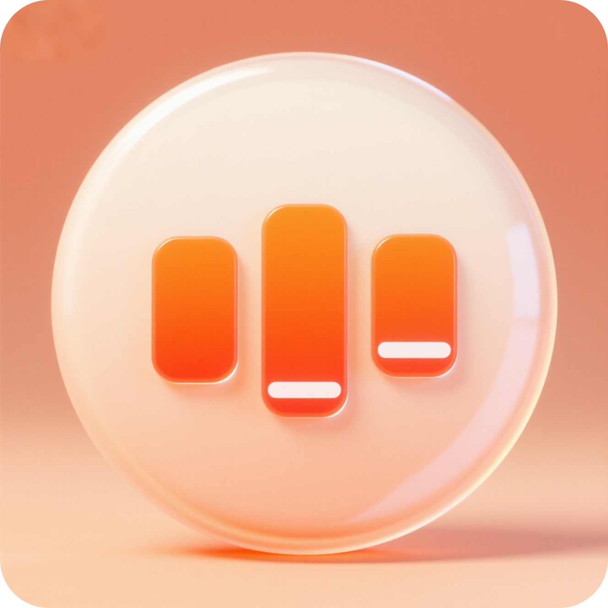

# Tune - Кросс-платформенный музыкальный плеер

<p align="center">
  
</p>

<p align="center">
  Пусть каждая мелодия найдет свой дом
</p>

<p align="center">
  <a href="README.md">中文</a> •
  <a href="README_en.md">English</a> •
  <a href="README_ja.md">日本語</a> •
  <a href="README_ko.md">한국어</a> •
  <a href="README_ru.md">Русский</a>
</p>

## 🎵 О Tune

В суете повседневной жизни всегда есть мелодии, которые тихо находят свой путь в ваше сердце - возможно, это бодрый ритм, который будит вас утром, нежная народная песня, которая сопровождает вас поздно ночью, или сюрприз-сингл, с которым вы сталкиваетесь в путешествии.

Tune - это больше, чем просто музыкальный плеер; это ваша личная "организация мелодий". Здесь вы можете легко организовать свою локальную музыкальную библиотеку, настроить плейлисты по стилю, настроению или сцене, гарантируя, что каждая песня будет ждать вас в идеальном месте. Благодаря плавному воспроизведению и тонкой настройке звука каждая нота в ваших наушниках звучит четко и полно, как будто вы находитесь на живом выступлении. Простой, но изысканный дизайн интерфейса воплощает чистую любовь к музыке, без отвлекающих факторов, предлагая только вас и вашу музыку.

Будь то классические песни, которые вы хранили много лет, или недавно открытые нишевые шедевры, Tune может аккуратно хранить их все, делая каждое открытие прекрасным воссоединением слуха.

С Tune музыка возвращается к своей сути, и каждый момент сопровождается мелодиями.

## 🌟 Особенности

- 🎧 **Высококачественное воспроизведение аудио** - Поддерживает различные аудиоформаты, включая MP3, FLAC, WAV
- 📚 **Управление локальной музыкой** - Автоматическое сканирование и организация локальной музыкальной библиотеки с анализом метаданных
- 🎨 **Поддержка нескольких тем** - 8 красивых тем (Модный Электро, Минималистичный Серый, Лес Природы, Кибер Нeon, Теплое Исцеление и др.) с автоматическим переключением темного/светлого режима
- 🌍 **Многоязычная поддержка** - Поддерживает китайский, английский, японский, корейский, русский языки
- 📱 **Кроссплатформенная совместимость** - Полная поддержка Android, iOS, Windows, macOS, Linux, Web
- ⚡ **Плавная работа** - Фоновое воспроизведение, управление уведомлениями, быстрый поиск
- 🎛️ **Персонализация** - Богатые возможности настройки шрифтов, тем, языков
- 🎯 **Умные рекомендации** - Персонализированные музыкальные рекомендации на основе истории воспроизведения
- 📥 **Автономное кэширование** - Поддерживает кэширование онлайн-музыки для офлайн-прослушивания
- 📋 **Плейлисты** - Поддерживает создание и управление пользовательскими плейлистами
- 🔄 **Несколько режимов воспроизведения** - Повтор списка, повтор одной песни, случайное воспроизведение
- ⏩ **Управление воспроизведением** - Поддерживает перетаскивание прогресса воспроизведения, регулировку громкости, изменение скорости воспроизведения (0,5x-2,0x)
- 🎵 **Синхронизация текстов** - Поддерживает отображение текстов в формате LRC в реальном времени
- 🔍 **Умный поиск** - Поддерживает поиск по названию песни, исполнителю, альбому

## 🎨 Предварительный просмотр тем

Tune предлагает несколько красивых тем на выбор:

1. **Модный Электро** - Современный электронный стиль с фиолетовыми тонами
2. **Минималистичный Серый** - Чистый дизайн в серых тонах
3. **Лес Природы** - Свежий зеленый природный стиль
4. **Кибер Нeon** - Футуристические неоновые цвета
5. **Теплое Исцеление** - Теплый оранжевый целебный стиль
6. **Теплый Оранжевый Градиент** - Теплый оранжевый градиентный стиль
7. **Монохром** - Минималистичный дизайн с унифицированными цветами
8. **Ярко-красный** - Страстная красная тема

Все темы следуют концепции дизайна "светлый и прозрачный в светлом режиме, изысканный и тонкий в темном режиме" с низкой насыщенностью цветов для создания ощущения роскоши.

## 🛠 Техническая архитектура

Tune построен с использованием паттерна Clean Architecture + BLoC для обеспечения удобства обслуживания и масштабируемости кода:

```
lib/
├── app/                    # Основная конфигурация приложения
│   ├── router/             # Управление маршрутизацией
│   └── theme/              # Система тем
├── core/                   # Ядро
│   ├── bloc/               # Глобальное управление состоянием
│   ├── config/             # Конфигурация приложения
│   ├── error/              # Обработка ошибок
│   ├── network/            # Сетевые функции
│   ├── services/           # Основные сервисы
│   ├── storage/            # Хранилище данных
│   ├── utils/              # Вспомогательные классы
│   └── widgets/            # Основные компоненты
├── features/               # Модули функций
│   ├── audio/              # Функции воспроизведения аудио
│   ├── home/               # Модуль главной страницы
│   ├── library/            # Модуль музыкальной библиотеки
│   ├── player/             # Модуль плеера
│   ├── profile/            # Модуль профиля
│   ├── search/             # Модуль поиска
│   └── settings/           # Модуль настроек
├── l10n/                   # Ресурсы интернационализации
└── di/                     # Внедрение зависимостей
```

## 🚀 Быстрый старт

### Требования

- Flutter SDK 3.8.1 или выше
- Dart SDK 3.8.1 или выше
- Поддерживаемая IDE (Android Studio / VS Code)

### Установка зависимостей

```bash
flutter pub get
```

### Запуск приложения

```bash
# Запуск в режиме разработки
flutter run

# Сборка для конкретных платформ
flutter build apk      # Android
flutter build ios      # iOS
flutter build web      # Web
flutter build windows  # Windows
flutter build macos    # macOS
flutter build linux    # Linux
```

## 🔧 Основные зависимости

- **Воспроизведение аудио**: [just_audio](https://pub.dev/packages/just_audio)
- **Управление состоянием**: [flutter_bloc](https://pub.dev/packages/flutter_bloc)
- **Маршрутизация**: [auto_route](https://pub.dev/packages/auto_route)
- **Локальное хранилище**: [hive](https://pub.dev/packages/hive), [shared_preferences](https://pub.dev/packages/shared_preferences)
- **Сетевые запросы**: [dio](https://pub.dev/packages/dio)
- **Внедрение зависимостей**: [get_it](https://pub.dev/packages/get_it)
- **Интернационализация**: [flutter_localizations](https://flutter.dev/docs/development/accessibility-and-localization/internationalization)

## 📱 Поддержка платформ

| Платформа | Статус    | Примечания |
|----------|-----------|------------|
| Android  | ✅ Поддерживается | API 21+ |
| iOS      | ✅ Поддерживается | iOS 11+ |
| Windows  | ✅ Поддерживается | Windows 10+ |
| macOS    | ✅ Поддерживается | macOS 10.15+ |
| Linux    | ✅ Поддерживается | Ubuntu 20.04+ |
| Web      | ✅ Поддерживается | Современные браузеры |

## 🤝 Вклад

Вклад в любой форме приветствуется! Если вы хотите внести свой вклад в Tune, пожалуйста, следуйте этим шагам:

1. Форкните репозиторий
2. Создайте свою ветку функций (`git checkout -b feature/AmazingFeature`)
3. Зафиксируйте свои изменения (`git commit -m 'Add some AmazingFeature'`)
4. Отправьте в свою ветку (`git push origin feature/AmazingFeature`)
5. Откройте Pull Request

## 📄 Лицензия

Этот проект лицензирован по лицензии MIT - см. файл [LICENSE](LICENSE) для получения подробной информации.

## 🙏 Благодарности

- Спасибо всем разработчикам, вносящим вклад в сообщество с открытым исходным кодом
- Спасибо команде Flutter за предоставление отличного фреймворка
- Спасибо JetBrains за поддержку инструментов разработки

---

<p align="center">
  С Tune музыка возвращается к своей сути, и каждый момент сопровождается мелодиями.
</p>